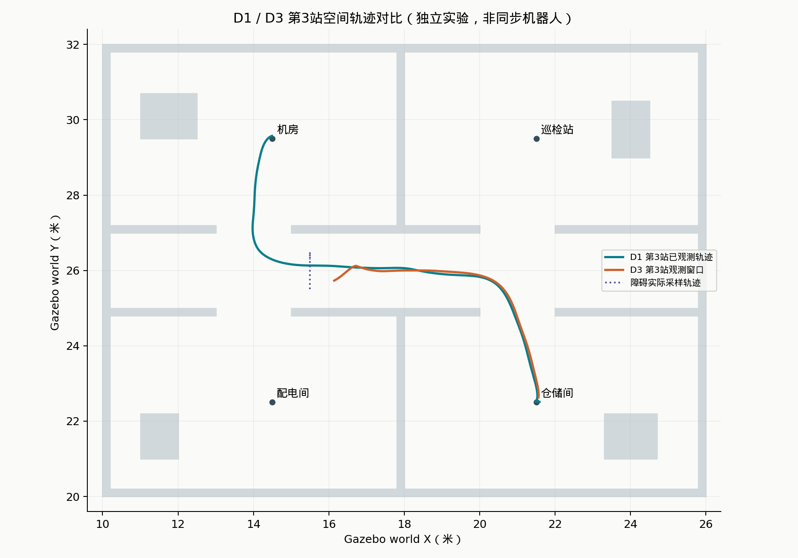
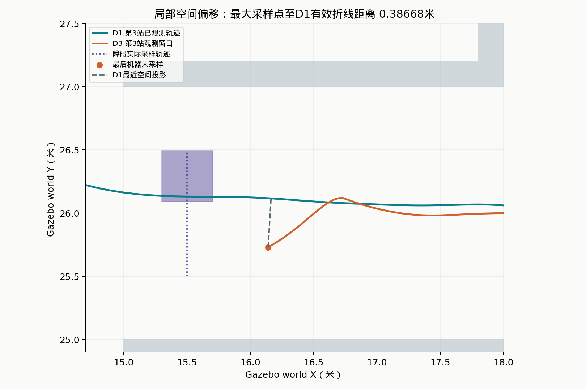
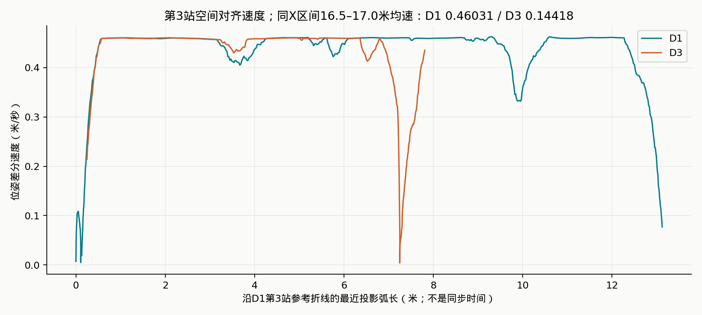
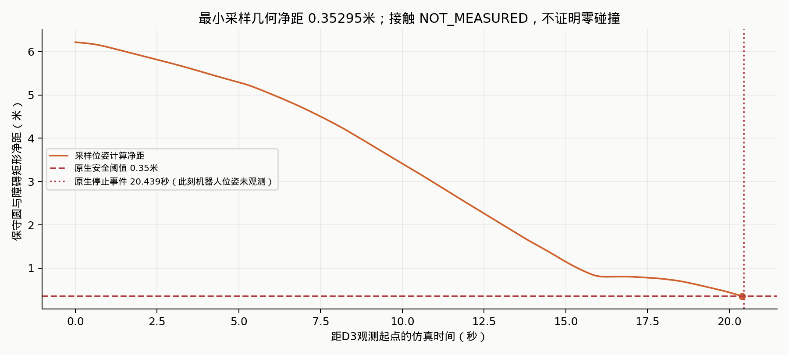

# Embodied-Agent V1.0

**从自然语言巡检指令，到可校验、可停止、可追溯的机器人导航。**

基于 **ROS2 Jazzy · Gazebo Harmonic · Nav2 · Qwen** 的具身导航原型。项目围绕室内巡检任务，连接语义规划、可信地点注册表、顺序执行、异常终止、动态障碍实验和离线证据回放。这是面向具身智能产品与机器人软件工程的可复现原型，不是生产级机器人系统。

**交付范围：V1.0私有仓库；未经维护者确认不公开。** 整体开源许可证尚未选定，第三方来源见[NOTICE](NOTICE.md)。

- [历史实验回放（本地页面）](web/replay/index.html) · [实验结果与四图复核](docs/STAGE62_RESULTS.md)
- **[Live Demo — Embodied-Agent Experiment Replay](https://embodied-agent-replay-dv5zxlbmp-sun-1ac1.vercel.app/)**：Vercel静态历史回放，保留现有访问保护。本次交付不修改Vercel项目、部署配置或保护设置。
- [安装与快速开始](#安装与快速开始) · [架构与信任边界](#架构与信任边界) · [交付与安全审计](docs/RELEASE_V1.0.md)

## 项目定位与核心能力

项目回答四个产品问题：用户的全部任务是否被忠实保留？坐标是否可信？执行异常后能否停止？实验结论是否有对应证据？

| 能力 | 实现与验证范围 |
|---|---|
| Hybrid Planner | Rule / Qwen / Ollama统一Provider；默认Rule，无静默切换、云端回退或自动模型重试。Rule、Qwen已有真实四站仿真留存；Ollama目前仅Mock验证。 |
| 任务忠实性 | 当前支持明确顺序导航语法，调用模型前检查全部地点；返回后复核步骤、顺序与重复次数。未知地点、遗漏、替换、额外动作或含糊指令停止规划。 |
| 可信执行计划 | 严格Schema、NAVIGATE白名单、1—20步、地点注册表唯一坐标来源；模型不能指定可信坐标或直接控制ROS。 |
| 多场景 | Sandbox与独立四室Inspection World；新场景绑定世界、地图、注册表与资产Manifest，防止跨地图复用坐标。 |
| V4执行器 | 多目标顺序导航、明确超时、确认取消、有限重试、CONTINUE / RETRY / HALT决策、非零失败退出码及原子报告。 |
| 可追溯性 | request_id区分模型调用；确定性plan_id标识可信计划；run_id标识单次执行；Provenance关联来源、模型、Token和耗时。 |
| 可靠性实验 | D1无障碍、D2单向、D3往返动态障碍；租约所有权、会话检查、显式Apply、心跳与几何净距保护、确认清理。 |
| 离线展示 | 真实采样轨迹回放、空间对齐速度/偏移、净距与安全停止事件；脱敏JSON可下载，不连接机器人。 |

## 架构与信任边界


模型只输出`{"steps":[{"action":"NAVIGATE","location":"配电间"}]}`这类意图。可信坐标由注册表补全，来源元数据由本地代码生成；计划哈希不能替代执行前验证。v2身份包含`scene_id`与`scene_assets.manifest_sha256`，保留顺序、重复步骤、动作和坐标，排除JSON排版及创建时间。历史v1标识保留兼容，不改写过去报告。

详见[Provider](docs/PROVIDERS.md)、[任务忠实性](docs/TASK_FIDELITY.md)、[计划标识](docs/PLAN_IDENTITY.md)、[多场景](docs/SCENES.md)。

## 从语义任务到四站巡检

输入：**“先去配电间，再去仓储间，接着去机房，最后去巡检站”**。

1. 本地契约识别四个有序地点，拒绝未知地点或无法可靠解析的表达。
2. 选定Provider生成意图；本地再次校验结构、动作及完整性，不能接受模型自行删掉步骤。
3. 地点注册表生成可信目标，绑定Inspection World 1.0.0资产和v2 Plan ID。
4. 操作者审阅计划，通过`planner.execute_plan --execute`明确启动导航；V4逐站执行并记录每次尝试和恢复决策。
5. Nav2负责路径规划、局部控制与自身恢复，Gazebo提供仿真反馈；V4报告保留真实终态与来源关联。

该链路已有真实Qwen → 可信计划 → V4 → Nav2 → Gazebo的四站仿真留存。本次GitHub交付只做离线验证，不重新运行导航或模型请求。

## 动态障碍实验 D1 / D2 / D3

以下为历史留存的独立单次运行，不是新执行结果或普遍成功率。

| 指标 | D1 无障碍 | D2 单向运动 | D3 往返运动 |
|---|---:|---:|---:|
| 最终V4导航 | **4/4 SUCCEEDED** | **4/4 SUCCEEDED** | **4/4 SUCCEEDED** |
| 障碍运动实验 | 不适用 | COMPLETED | **FAILED：净距保护提前停止** |
| 配置速度 / 时长上限 | 不适用 | 0.15m/s / 15s | 0.20m/s / 25s |
| 障碍观测窗口（仿真秒） | 无注入障碍 | 6.819 | **20.394** |
| 观测Y方向反转 | 不适用 | 0 | **3** |
| 最小采样几何净距 | 不适用 | 5.51817m | **0.35295m** |
| 原生运动停止 / 清理 | 不适用 | LATCHED_ZERO_COMMAND / CLEAN | LATCHED_ZERO_COMMAND / CLEAN |
| 观测质量 | INCOMPLETE | VALID_OBSERVATION_WINDOW | **INCOMPLETE** |
| 接触测量 | NOT_MEASURED | NOT_MEASURED | **NOT_MEASURED** |

**D3未完成25秒运动。** 停止原因`NATIVE_STOP_ROBOT_CLEARANCE_GUARD`；这与后续V4四站导航全部成功同时成立。最后机器人采样在20.394s，原生停止事件在20.439s，事件时机器人位姿未观测，不外推净距。**接触未测量，不能宣称零碰撞。** D2到界结束且未形成近距离交会，不能据此声称已验证近距离横穿避障。D3的21次Path变化只是代理指标，不是21次正式重规划。

### D1 / D3轨迹与指标





D3采样点到D1第3站有效参考折线的最大单向距离为**0.38668m**，不是连续轨迹的上界。仅比较同一任务与空间位置，不把不同实验的绝对仿真时间当作同步时间。



同X带`16.5–17.0m`内，裁剪有效线段后按路程/仿真时长计算：D1 **0.46031m/s**，D3 **0.14418m/s**，描述性降低约**68.68%**。第3站V4墙钟耗时分别33.51s、37.76s。初始条件和采集窗口不同，不能将全部速度/时间差归因于障碍。



净距由0.22m保守机器人圆与障碍有向矩形计算，仅针对注入障碍。原始图、数据来源、算法、实测/计算/现场观察/不可证实结论的区别见[实验结果](docs/STAGE62_RESULTS.md)。

## 安全停止、心跳与异常处理

- **默认不执行**：Planner不发送目标；`execute_plan`、V4默认预检查，真实导航必须有`--execute`。障碍工具默认Dry Run，真实修改必须显式Apply。
- **活动目标生命周期**：区分目标拒绝、失败、确认取消、状态未知；发送应答超时不能当成普通失败盲目重试。无法确认终止则UNKNOWN，停止任务链。
- **有限重试**：只对已确认CANCELED的超时进行策略允许的有限重试；Nav2内部恢复与V4任务级决策分开记录，不将二者混称Agent自主恢复。
- **运动监督**：原生心跳阈值0.5秒；只有任务、会话、真实位姿、运动状态及安全监督仍新鲜，Python才能保活。保留0.35m净距门禁、速度/加速度限制和唯一身份绑定。不是硬实时物理停机证明。
- **结果可靠性**：SUCCEEDED退出0；FAILED / TIMED_OUT / UNKNOWN / 中断非零。上层还复核完整报告、计划和来源，不以子进程退出为成功依据。
- **落盘与清理**：原子写入报告、拒绝覆盖已有报告；运行中写盘失败会停止任务链并尝试取消。障碍租约清理无法确认时保留UNKNOWN，不能伪报CLEAN。

详见[安全审查](docs/SAFETY_REVIEW.md)、[Stage 6.1](docs/STAGE61.md)、[Stage 6.2](docs/STAGE62.md)、[心跳修复](docs/D3_HEARTBEAT.md)。历史实验命令中的原始日志/模型来源文件仅在维护者本地保留，不随Git发布。

## 安装与快速开始

### 仅离线规划、测试和回放

Python ≥3.10；验证环境为Ubuntu 24.04 / Python 3.12。此路径不需要运行ROS、Nav2、Gazebo或模型服务。克隆私有仓库需要账户访问权限：

```bash
git clone https://github.com/yiasun/embodied-agent.git
cd embodied-agent
python3 -m venv .venv
source .venv/bin/activate
python3 -m pip install -e '.[test]'

# 全部离线测试；测试层禁止网络连接
PYTHONDONTWRITEBYTECODE=1 python3 -B -m pytest -q -p no:cacheprovider

# 用已发布的真实脱敏采样重算指标，不需要原始日志
python3 -B -m replay.public

# 默认Rule；只生成计划，不联网、不控制机器人
LLM_PROVIDER=rule python3 -B -m planner.agent_planner \
  '先去配电间，再去仓储间，接着去机房，最后去巡检站' --scene inspection_world

# 既有示例计划的只读预检查
python3 -B -m planner.execute_plan --plan plans/plan_nl_v1.json
```

`pyproject.toml`声明`jsonschema`及测试依赖`pytest`；本次交付没有安装或升级ROS依赖。`.env.example`只有模板，不自动加载；真实密钥仅通过环境变量提供，不能提交、打印或写入日志。

### 本地历史回放

直接在浏览器打开`web/replay/index.html`，数据已打包，无前端依赖、CDN或后端。WSL操作者可运行：

```bash
explorer.exe "$(wslpath -w "$PWD/web/replay/index.html")"
# 可选HTTP，仅绑定本机，只服务脱敏展示目录
python3 -m http.server 8765 --bind 127.0.0.1 --directory web/replay
```

HTTP模式访问`http://127.0.0.1:8765`，Ctrl+C停止。不要以项目根目录启动静态服务，不把ROS/Gazebo/WSL端口暴露公网。Vercel仍使用原有静态回放部署和访问保护，页面无实时控制功能。

`replay.public`只验证公开几何、可信计划绑定和计算一致性；原始模型请求/租约的完整来源核验依赖维护者私有日志。`replay.build --figures`是维护者从私有原始报告重建派生证据的命令，新克隆仓库不能假装拥有这些未发布记录。图表生成额外需要本地Matplotlib与CJK字体。

### ROS2仿真运行（用户手动触发）

已验证环境：Ubuntu 24.04、ROS2 Jazzy、Gazebo Harmonic、Nav2及`nav2_minimal_tb3_sim`。系统ROS依赖由对应ROS发行版提供；本仓库不是完整ROS发行版安装器。先按[场景文档](docs/SCENES.md)核对本机资源，再由操作者明确运行：

```bash
source /opt/ros/jazzy/setup.bash
python3 -B -m scenes.manage --scene inspection_world
ros2 launch "$PWD/launch/scene.launch.py" \
  scene_id:=inspection_world headless:=False use_rviz:=True
```

在独立终端用系统ROS Python生成全新计划包并预检查：

```bash
source /opt/ros/jazzy/setup.bash
LLM_PROVIDER=rule python3 -B -m planner.agent_planner \
  '先去配电间，再去仓储间，接着去机房，最后去巡检站' \
  --scene inspection_world --output-dir /tmp/inspection-v1-new
python3 -B -m planner.execute_plan --plan /tmp/inspection-v1-new/plan.json \
  --provenance /tmp/inspection-v1-new/provenance.json
```

确认地图、AMCL、TF与Nav2生命周期就绪后，**只有操作者明确决定执行**才在最后一条命令末尾增加`--execute`。不要并行启动共享同一ROS图的两个场景。若使用虚拟环境，应确认它能访问系统ROS Python包；离线测试虚拟环境不等于ROS运行环境。

Qwen使用阿里云百炼OpenAI兼容接口：`LLM_PROVIDER=qwen`、`QWEN_MODEL=qwen-plus`、可配置`QWEN_BASE_URL`和环境密钥`QWEN_API_KEY`。显式选择可能产生计费请求，本次不调用。Ollama设置`LLM_PROVIDER=ollama`、本地`OLLAMA_BASE_URL`及实际安装的`OLLAMA_MODEL`，不假设存在模型，不自动安装或回退。详见[配置说明](docs/PROVIDERS.md)。

## 仓库结构与复现边界

```text
planner/       Provider、任务契约、意图/计划校验、身份与执行入口
day4/          V4导航状态机、Recovery Policy、原子报告
configs/       场景地点注册表与资产索引
assets/        Inspection World世界/地图/Manifest、外部资源说明
scenes/        几何、栅格与资产一致性校验
reliability/   观测、障碍租约、原生有界运动与心跳保护
replay/        历史数据计算、公开证据复核与维护者绘图工具
web/replay/    独立静态回放与脱敏JSON
tests/         无网络离线测试，明确区分合成Mock与真实公开证据
docs/          架构、安全设计、实验方法及图表
tools/         场景构建、发布白名单审计与导出
```

原始日志、真实模型响应/来源包、所有权token、机器审计JSON、`.env`、Git元数据、缓存、编译产物、快照和临时大文件不上传。仅保留三个经审查的纯计划示例以及脱敏真实回放。完整本地工程**881项通过**；不含原始日志的交付副本**879通过、2跳过、0失败**，跳过的两项明确依赖维护者私有历史记录，不能算作通过。其余单元/Mock/公开证据复算测试不依赖私有日志。交付清单见[发布记录](docs/RELEASE_V1.0.md)。

## 局限性与Roadmap

- 当前语义能力限定为明确顺序导航；不把地点词匹配当作通用语义理解，不支持任意复杂任务、操作、开放式工具调用或推测性执行。
- D1/D2/D3是有限单次仿真实验，观测不覆盖完整导航。未测接触、端到端传感器延迟；不能证明零碰撞、因果避障效果或量产可靠性。
- Nav2恢复、V4策略和障碍原生保护是不同层级；本项目没有证实新的通用Agent自主恢复能力。
- 缺少实机验证、更多随机种子/速度/交会时序的重复实验、真实Contact采集、可验证的正式Planner调用计数及真实持续运动多障碍评测。
- 后续计划：补齐上述测量和重复实验 → 扩展有边界的任务意图与澄清交互 → 评估Ollama真实接入 → 实机迁移与部署运维。均为Roadmap，尚未完成。
- 当前交付保持私有；整体许可证、第三方许可复核及公开展示范围确认后，再讨论公开发布。实时Gazebo云端控制不属于本版静态Demo。
