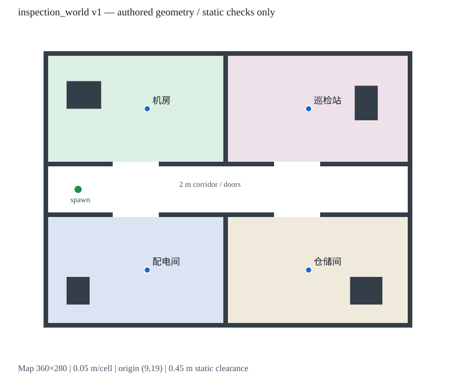

# 第二场景工程交付：inspection_world 1.0.0

本次完成独立世界、匹配的解析地图、地点注册表、资产版本接入和离线校验。
未调用真实Qwen API、启动Gazebo/RViz/Nav2或发送导航目标；未改写历史数据、Sandbox配置或/opt安装文件。



## 本机资源审计

详细路径、插件、Fuel URI、包版本和SHA-256在维护者本地`SCENE_RESOURCE_AUDIT.json`保留；该机器审计文件不随Git分发。发布资产来源和版本见[资产说明](../assets/scenes/inspection_world/v1/NOTICE.md)。

| 地图 | 栅格 | 分辨率 | 原点(x,y,yaw) | 覆盖尺寸 |
| --- | --- | --- | --- | --- |
| tb3_sandbox | 384×384 | 0.05m | (-10,-10,0) | 19.2×19.2m |
| depot | 604×307 | 0.05m | (-7.14,-7.83,0) | 30.2×15.35m |
| warehouse | 1006×1674 | 0.03m | (-15.1,-25,0) | 30.18×50.22m |
| inspection_world | 360×280 | 0.05m | (9,19,0) | 18×14m |

确实找到了`nav2_minimal_tb4_sim/worlds/{warehouse,depot}.sdf`。TB4官方launch明确指定depot地图/世界，并注释warehouse替代组合，因此配套意图有代码证据，不是按同名猜测。
两者使用gz-sim系统插件，具有Harmonic接口兼容证据；但它们依赖远程Fuel中的Depot/Warehouse、货架等模型，已检查的用户Gazebo缓存没有这些模型。未下载或启动世界，不能离线证明完整碰撞网格与PGM一致。
故本版本不把它们标成“已校验可导航场景”，也没有按地图猜造三维墙体。

现有Sandbox Xacro引用`turtlebot3_world`模型，旧模型含圆柱/盒体和Classic材质；保留原样。机器人继续使用系统Waffle、GPU lidar、odom/tf及cmd_vel桥接。
现有Nav2模板：AMCL(map/odom/base_footprint)、Navfn Planner、MPPI Controller、BT Navigator；代价地图0.05m、robot_radius=0.22m、inflation_radius=0.7m。

## 新场景的几何与地图证据

源文件：`assets/scenes/inspection_world/v1/geometry.json`。

- 建筑包络x=10…26、y=20…32，四个独立房间及中央通道。
- 中央通道y=25…27；南北门洞均为2m宽。
- 0.2m墙、2m墙高；四个静态设备/货架高1.2m。
- 地面覆盖整张地图，四房间有不同颜色的低位视觉地板；这些地板不产生激光平面的障碍。
- 世界内部名保留`default`以适配现有TB3创建/桥接约定；场景资产和布局是独立新建的，并非Sandbox复制改名。
- map坐标与Gazebo世界坐标的变换为恒等；YAML origin只是栅格左下角，不是额外的world偏移。

| 地点 | x | y |
| --- | --- | --- |
| 配电间 | 14.5 | 22.5 |
| 仓储间 | 21.5 | 22.5 |
| 机房 | 14.5 | 29.5 |
| 巡检站 | 21.5 | 29.5 |

出生点/AMCL初始位姿为(11.5,26.0, yaw=0)，机器人spawn z=0.01m。

地图依据：所有墙体/障碍边界严格落在0.05m格线；生成器按碰撞矩形覆盖格子，PGM北向行与ROS南向行显式转换。
校验器独立解析SDF的model/link/collision位姿和box尺寸，再逐像素复核地图；不依赖同名文件或只比较哈希。
16个障碍矩形产生9480个占据格；四个目标及出生点均在空闲区。按保守0.45m圆盘净空膨胀后，39623个安全格与出生点连通，四点均在该连通分量中。
这证明静态净空路径存在，不证明Nav2实际选路、控制或定位已经通过。

Harmonic本机`gz sdf -k`返回Valid；现有xacro工具转换通过，转换后碰撞投影仍逐像素等于地图。
已构造ROS launch描述对象检查资源参数，但没有运行LaunchService或启动任何进程。

## 资产身份与旧版本兼容

- 新配置：`configs/scenes/inspection_world.json`。
- 索引：`configs/scene_resources/index.json`，整体绑定world/map/image/nav2/几何源/模板及清单哈希。
- 清单：`assets/scenes/inspection_world/v1/manifest.json`，版本1.0.0。
- 清单SHA-256：`0e11a5a73a327b1dbfddde91ca619afdb02ae7556572d6b536414b13001d9115`。
- world SHA-256：`cbbde11dca1a1f71b4102cf5e04f7cd6396dd2c427e046c8f41c6fa28c92ab40`。
- PGM SHA-256：`06f0eb4a0de8a5d2676e886015b37457b6c4d142bd152ce0cb2a97a8b4a13f80`。

文件存在、路径/符号链接边界、哈希、来源几何、地图配置、坐标、净空、连通性及Nav2参数都必须通过。文件变动后不会自动重建/更新哈希来“修好”验证。
即使只改mtime或同时重算单个文件哈希，几何与地图不一致仍被拒绝。已管理场景不能删除assets元数据降级绕过。

旧Sandbox计划保持schema1.0和`trusted-plan-sha256-v1`，原A→B语义ID仍为`e205afb6…9e738e3`。
新资产场景使用schema2.0和`trusted-plan-sha256-v2`，额外将scene_assets的revision和manifest_sha256纳入哈希。
旧v1算法的投影没有改变；未重写历史计划/报告。新场景没有资产字段、资产版本不符或混入旧场景坐标时拒绝执行。
来源metadata及V4报告跟随计划选择对应算法；Provider、任务忠实性、Action取消/恢复策略继续复用。

新场景显式执行前，以及每个目标/重试之前，会只读检查当前`/map`：尺寸、分辨率、原点、坐标系、旋转及全部栅格必须匹配。旧Sandbox地图或读图超时则停止，不发送该目标。
此防护不会自动切换地图或修改生命周期。

## 离线命令（现在即可运行）

```bash
cd ~/embodied-agent
python3 -B -m scenes.manage --scene inspection_world
python3 -B tools/build_inspection_scene.py
PYTHONDONTWRITEBYTECODE=1 python3 -B -m pytest -q -p no:cacheprovider

LLM_PROVIDER=rule python3 -B -m planner.agent_planner \
  '先去配电间，再去仓储间，接着去机房，最后去巡检站' \
  --scene inspection_world --output-dir /tmp/inspection-demo-new

python3 -B -m planner.execute_plan --plan /tmp/inspection-demo-new/plan.json
python3 -B -m day4.task_executor_v4 --plan /tmp/inspection-demo-new/plan.json
```

输出目录必须全新；后两条都是预检查，不发送目标。
四点计划语义ID为`c14287a68250a91862a14b1618ca73d63efa2e7a011484cc8c18849433ec2e7e`，不随created_at或目录变化。
默认Rule不调用模型。生成器默认只检查可重现性；`--write`是开发者显式重建未发布v1资产的操作，不会更新资源索引以掩盖版本差异。发布几何修改应创建新版本目录并审查更新索引。

## 用户后续人工仿真验收（本次未运行）

先由操作者正常结束旧仿真/导航会话并确认机器人停止；不要并行启动两个共享`/map`、TF和`/navigate_to_pose`的场景。
新开终端：

```bash
source /opt/ros/jazzy/setup.bash
cd ~/embodied-agent
ros2 launch "$PWD/launch/scene.launch.py" \
  scene_id:=inspection_world headless:=False use_rviz:=True
```

包装launch只接受scene_id/headless/use_rviz，不暴露可随意混搭的world/map覆盖项。资源校验通过后，复用系统tb3_simulation_launch，以新world、map、参数和出生点整体启动。
不会修改/opt文件。系统TurtleBot3网格和桥接仍是本地依赖。

定位验收：

1. Gazebo应显示四房间、中央通道、门洞和四个设备，机器人在(11.5,26)。
2. RViz固定坐标系map，确认激光点与墙重合，`/map`原点和地图尺寸正确。
3. 参数已启用AMCL初始位姿(11.5,26,0)。等待scan/clock/TF就绪；若未收敛，通过RViz的2D Pose Estimate在该位置按+x方向重新初始化。此动作需操作者执行。
4. 只读确认AMCL、Planner、Controller、BT Navigator为Active，存在map→odom→base链且AMCL姿态与出生点一致。节点“存在”不等于已Active。
5. 未定位、激光偏移、地图不符或生命周期未就绪时，不发送任务。先排查，不将失败算作验证成功。

明确决定导航验收后，才单独运行：

```bash
python3 -B -m planner.execute_plan --plan /tmp/inspection-demo-new/plan.json --execute
```

这条会发送真实仿真目标，本次没有运行。四点都需SUCCEEDED，坐标/顺序与计划一致；保存新报告、来源及视频，核对plan_id、run_id、source和Recovery决策。
若失败保留原报告，检查门洞通行、AMCL收敛、GPU lidar、实时率和MPPI行为，不改写失败为成功。

回到Sandbox应结束新会话后再明确选择`scene_id:=turtlebot3_demo`，或沿用原已验证启动方式；不要把新场景的初始位姿应用于Sandbox。

## 测试、文件和限制

原460项测试文件未改动且全部通过；新增51项，总计511项全部通过（最终结果）。
覆盖资源哈希、独立SDF投影、重现性、地图坐标转换、净空/连通性、资源篡改、降级/跨场景拒绝、v1身份保持、v2来源与模拟执行关联，以及活动地图变化阻止下一目标。

主要新增：scenes包、inspection资产目录、场景JSON及资源索引、launch包装、生成工具、离线测试、资源审计和布局图。
主要修改：Planner资源验证、双版本计划Schema/ID分派、来源/报告算法分派、V4地图只读门禁、包发现配置及README。
Action状态机和Recovery Policy未修改。

边界：

- 未做真实第二场景导航、定位或渲染验收，不能写成已跑通。
- 解析地图只适用于本版本受限的静态、轴对齐盒体、平地剖面；不支持复杂mesh、斜墙、悬空物或动态障碍的自动投影。
- 静态连通性是保守圆盘检查，不替代实际底盘运动学、定位噪声和控制器评测。
- `/map`门禁不能证明Gazebo实际加载的是哪份几何；应使用受控launch并人工核对激光和场景。单次活动目标期间不支持热切场景。
- 历史手动纯坐标入口保留且不提供场景语义认证；多场景Agent任务必须使用完整版本化计划入口。
- 运行方式是当前源码仓库和系统ROS包，不是独立打包的ROS发行包；更换系统机器人或插件后需重新审计。
- 本地哈希防止误配与意外变更，不是对有写权限者的数字签名。
