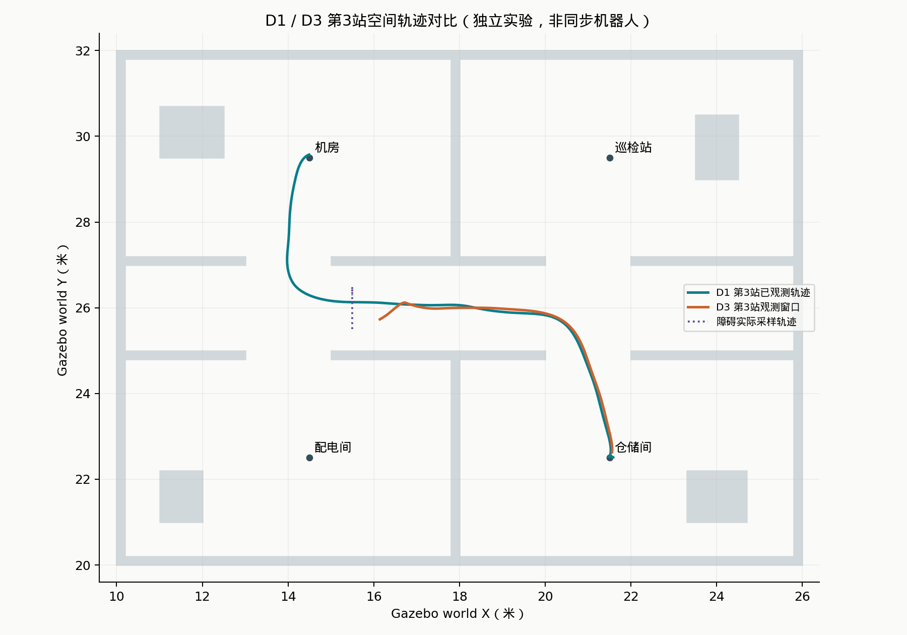
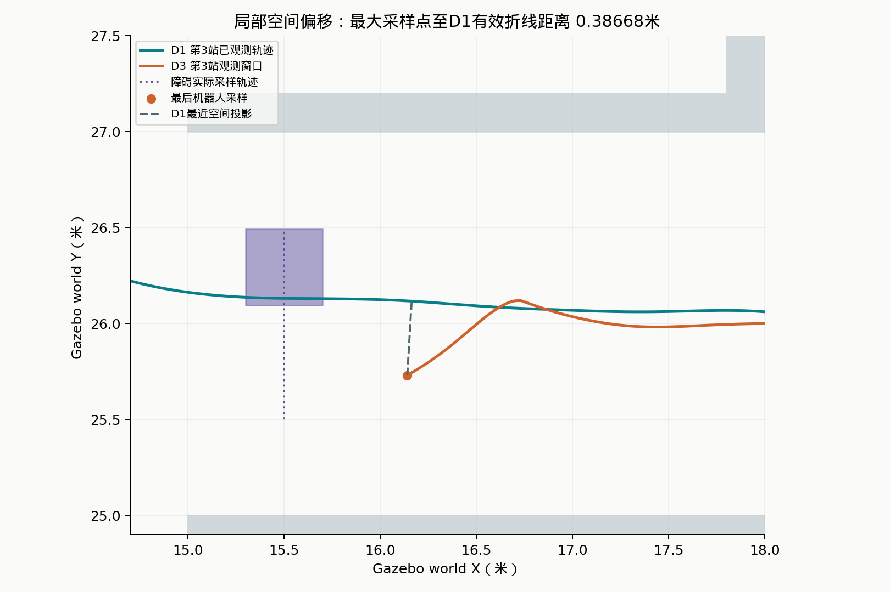
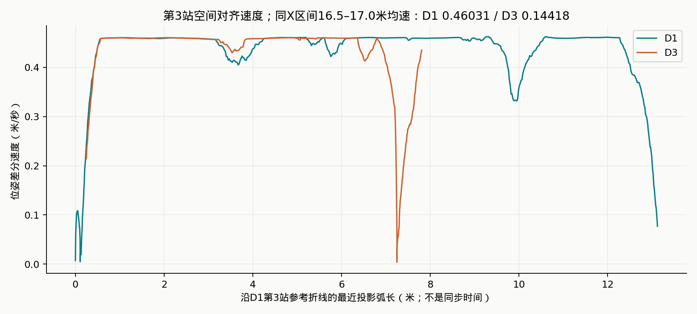
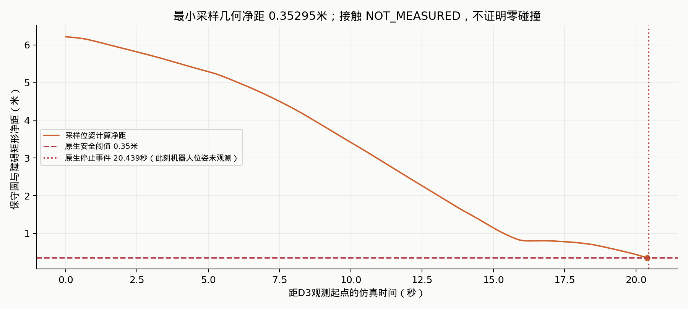
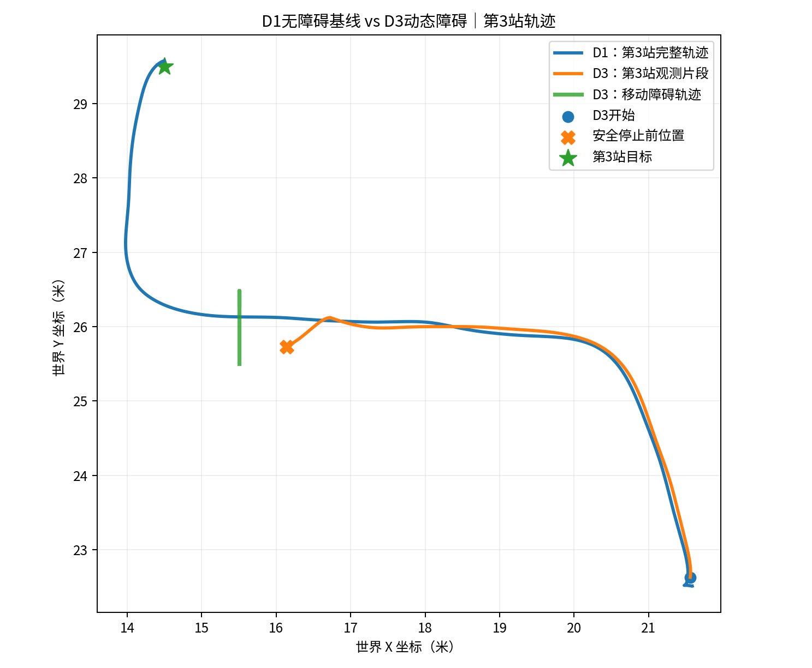
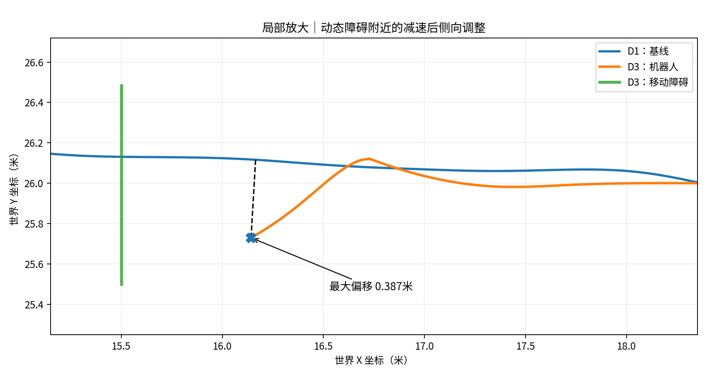
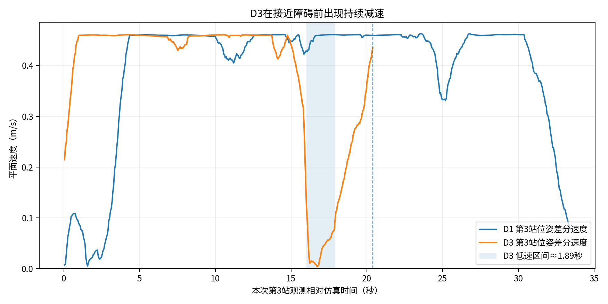
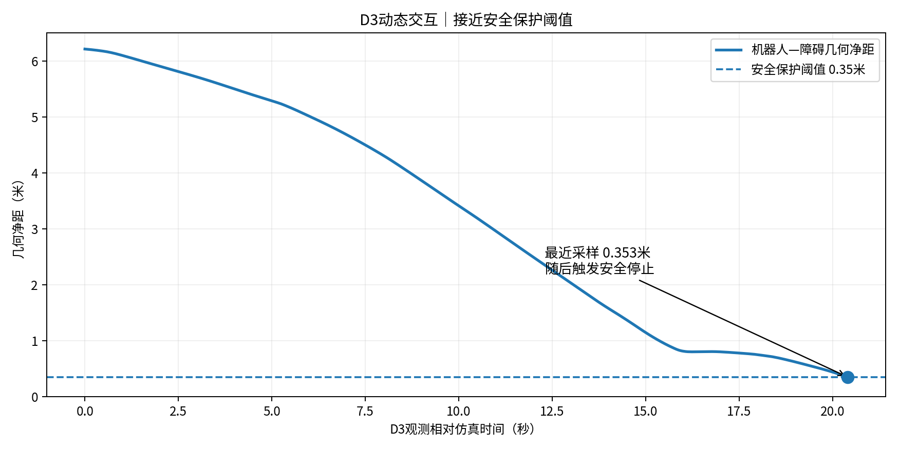

# Stage 6.2：历史实验证据与离线回放

本页复核2026-11-09留存的D1、D2、D3报告，不是新实验。独立展示模块见[本地回放页面](../web/replay/index.html)，不连接ROS/Gazebo、不调用模型、不发送控制命令。正式场景v1、Planner、V4、原生插件、心跳与安全门禁均保持原样。

## 实验结果

三次最终V4报告均为四站`SUCCEEDED`：配电间 → 仓储间 → 机房 → 巡检站。**D3运动实验本身FAILED**，因为安全净距门禁提前停止；这与机器人后续完成巡检并不矛盾。

| 指标 / 证据类型 | D1 无障碍基线 | D2 单向运动障碍 | D3 往返运动障碍 |
|---|---:|---:|---:|
| 最终导航（V4记录） | 4/4 SUCCEEDED | 4/4 SUCCEEDED | 4/4 SUCCEEDED |
| 运动租约状态（Journal） | 不适用 | COMPLETED | FAILED |
| 配置速度 / 时长上限 | 不适用 | 0.15m/s / 15 sim s | 0.20m/s / 25 sim s |
| 整个采集窗口（仿真时间） | 113.463s | 6.819s | 20.394s |
| 整个窗口采样数 | 2095 | 127 | 378 |
| 第3站回放采样数 / 窗口 | 619 / 33.411s | 127 / 6.819s | 378 / 20.394s |
| 第3站有效采样折线路程（计算） | 13.12439m | 1.97803m | 7.80662m |
| 障碍Y轴方向反转（采样计算） | 不适用 | 0 | 3 |
| 最小采样几何净距（计算） | 不适用 | 5.51817m | 0.35295m |
| 第3站任务耗时（V4墙钟） | 33.51s | 34.31s | 37.76s |
| 四站任务耗时（V4墙钟） | 34.86 / 33.11 / 33.51 / 33.50s | 33.16 / 33.52 / 34.31 / 33.86s | 20.77 / 33.17 / 37.76 / 33.06s |
| 采集质量 | INCOMPLETE | VALID_OBSERVATION_WINDOW | INCOMPLETE |
| 全程导航采样覆盖 | NOT_ASSERTED | NOT_ASSERTED | NOT_ASSERTED |
| Path发布 / 同任务变化代理（整个窗口） | 112 / 107 | 8 / 7 | 22 / 21 |
| 正式Planner调用次数 | UNKNOWN（null） | UNKNOWN（null） | UNKNOWN（null） |
| 原生障碍停止原因 | 不适用 | TRAJECTORY_COMPLETE | ROBOT_CLEARANCE_GUARD |
| 原生运动停止 / 清理（记录） | 不适用 | LATCHED_ZERO_COMMAND / CLEAN | LATCHED_ZERO_COMMAND / CLEAN |
| Contact / 传感器延迟 | NOT_MEASURED | NOT_MEASURED | NOT_MEASURED |

D2到达轨迹边界后正常结束，不能说完成了15秒持续运动。D2净距始终很大，未形成近距离交会，不能仅凭它证明近距离横穿避障。D1与D3的`issues=[]`也不等于完整采集。页面回放聚焦共同的第3站，四站卡片来自最终V4报告，不会补画第4站未采集的轨迹。

## 四张图与复算方法

用户提供的四张PNG已逐张查看，中文字正常，没有发现乱码或缺字。原图及初稿分析保持不变。正文采用同一原始JSON重新生成的四张复核版：将“完整轨迹”改为“已观测轨迹”，并将速度对比改为任务/空间对齐。中文使用本机Droid Sans Fallback，拉丁字符使用DejaVu Sans，绘图无缺字警告。





**空间偏移：0.38668085m。** 筛选`task_id=3`，仅用已标记有效、时间递增且间隔不大于0.25仿真秒的相邻D1采样点构造参考折线。每个D3采样点投影到最近有效线段，取欧氏距离的最大值。保持轨迹次序，缺口不连线；投影弧长允许回退。不是按绝对仿真时刻相减，也不是同步运行的两个机器人；该数值是单向采样偏移，不是连续轨迹或双向Hausdorff距离上界。



**同一空间X带内有明显减速。** 速度由Gazebo world位姿在有效相邻采样间的平面位移除以仿真时差计算，不把配置速度或odom命令当成真实速度。筛选同一任务，在`X ∈ [16.5,17.0]m`内对每条有效线段按边界裁剪，累加其窗口内路程与仿真时长，所有重复经过均计入。只为数值积分采用分段线性假设，回放不插值：

| 空间带内积分 | D1 | D3 |
|---|---:|---:|
| 路程 | 0.50057949m | 0.56023689m |
| 仿真时长 | 1.08747999s | 3.88565315s |
| 路程 / 时长 | 0.46031145m/s | 0.14418088m/s |

描述性降幅为`1 - 0.14418088 / 0.46031145 = 68.6775%`。初稿0.143m/s取决于样本筛选与平均口径，正式展示采用上述可复算口径。X带是同一走廊的空间筛选，不能等同于两次运行的严格配对。D3有效采样中最长连续低于0.1m/s约1.893仿真秒；D1也存在启动等低速段，不能说基线完全没有减速。

第3站V4墙钟时长增加4.25秒（约12.68%）。两次为独立单次运行、起始状态/观测覆盖不同，不能将全部时差或偏移归因于障碍，不能把仿真秒与墙钟秒混用。



**净距为几何计算，不是接触测量。** 使用配置的0.22m保守机器人圆与障碍0.4×0.4m有向矩形的有符号间距；重算结果与原采集的每个净距值核对。仅覆盖注入障碍，不是与所有墙体/物体的全局最小距离。

D3最后机器人采样在相对仿真`20.394s`，最小采样净距为`0.35294655m`。原生状态在`20.439s`记录`ROBOT_CLEARANCE_GUARD`，比机器人最后采样晚45ms，随即`LATCHED_ZERO_COMMAND`。因此采样净距仍略高于0.35m门禁并不矛盾；事件时刻没有同步机器人位姿，页面显示“未观测”，不把最后位姿冒充事件位姿，也不推算当时净距。Journal错误为`NATIVE_STOP_ROBOT_CLEARANCE_GUARD`，清理`CLEAN`。25秒往返运动未完成。

## 事实分层

| 类型 | 本次可支持的表述 |
|---|---|
| 仿真真实观测 / 原始记录 | Gazebo采样位姿与仿真时间戳、原生停止状态、清理确认、V4四站终态与墙钟耗时。这些是留存记录，不是本轮重新运行的结果。 |
| 离线计算 | 相邻位姿差分速度、有效折线路程、空间投影偏移、圆—矩形净距、Y方向反转次数、同X带均速及降幅。必须附采样/模型限制。 |
| 用户现场观察 | Gazebo中发生减速与绕行，作为现场描述；没有同步录像证据时不将它当作独立测量。 |
| 无法证实 | 零碰撞、完整25秒D3运动成功、21次正式重规划、所有轨迹变化的因果归属、全程导航无风险、Agent任务级自主恢复的新增能力、普遍成功率。 |

Nav2内部恢复节点的观测转换与V4的`CONTINUE/RETRY/HALT`分开保留。本次三个V4报告均记录`CONTINUE:4`；没有证据支持把障碍原生保护停止称为Agent自主恢复。Contact均`NOT_MEASURED`，不能由位姿净距声称零碰撞；传感器端到端延迟也未测量。

## 证据与标识

三次均绑定`inspection_world`资产1.0.0：

- Manifest SHA-256：`0e11a5a73a327b1dbfddde91ca619afdb02ae7556572d6b536414b13001d9115`。
- Plan ID（`trusted-plan-sha256-v2`）：`c14287a68250a91862a14b1618ca73d63efa2e7a011484cc8c18849433ec2e7e`。
- Provenance ID：`5ec24cfefe7e94ca0160bf75a48881d1c5b964501c8cfa6336cbd47a33c807d0`。

| 实验 | 观测JSON（位于`logs/reliability/`） | 最终V4报告（位于`logs/`） |
|---|---|---|
| D1 | `D1_retry_20261109_122902_735173165.json` | `task_v4_da23b2b26cd1492fb798b59b94dee77e.json` |
| D2 | `D2_handshake_20261109_140727_574372922_metrics_final.json` | `task_v4_6cbabd91908f496389b4b38a7e06d6d3.json` |
| D3 | `D3_heartbeat_20261109_170747_737199338_metrics_final.json` | `task_v4_d15c3309d9024ceda4e161e08aa407da.json` |

D2/D3还读取同前缀`_metrics.json`和Journal `.json`，验证final文件声明的输入SHA-256、采样/路径/BT/质量/指标未被finalization改写；验证租约、实体、native trace身份一致。构建时重新验证可信计划、注册表坐标、资产哈希、Provenance摘要以及最终V4报告。保留实际run_id，公开数据将原始lease_id改为不可用于控制的SHA-256引用。

[原始文件名与SHA-256清单](../web/replay/data/sources.json)说明派生数据所依据的文件；[脱敏回放JSON](../web/replay/data/evidence.json)中`frames[].source_row`是原观测`samples`的**零基行号**，`events[].native_trace_row`是Journal的`motion_trace`零基行号。前者时间以本次第3站首条采样为0，后者减去相同起点；绝不将不同实验的绝对仿真时间对齐。地图来自已校验的正式几何。哈希证明本地完整性关联，不是数字签名。

对外仅提供白名单派生数据：不复制原始报告、绝对路径、插件路径、环境变量、模型调用request_id、lease所有权凭证、entity_name或原生token。没有读取`.env`或实际API Key。

## 本地运行与复现

推荐直接在浏览器打开`web/replay/index.html`。数据已打包为本地脚本，`file://`可用，无CDN、后端或构建步骤。WSL可由操作者运行：

```bash
cd ~/embodied-agent
explorer.exe "$(wslpath -w "$PWD/web/replay/index.html")"
```

若浏览器/编辑器限制本地文件，可只服务脱敏展示目录，并且仅绑定回环地址：

```bash
python3 -m http.server 8765 --bind 127.0.0.1 --directory web/replay
# 本机浏览器访问 http://127.0.0.1:8765 ，Ctrl+C 停止。
```

不要将项目根目录作为静态站点根目录；它包含原始日志与本地配置。本页面没有实时Gazebo/ROS/WSL服务连接，不需要暴露这些端口。

重新生成派生JSON及四张图，只读取历史数据，写入独立输出目录：

```bash
PYTHONDONTWRITEBYTECODE=1 python3 -B -m replay.build
MPLCONFIGDIR=/tmp/embodied-replay-mpl python3 -B -m replay.build --figures
PYTHONDONTWRITEBYTECODE=1 python3 -B -m pytest -q -p no:cacheprovider
```

JSON转换使用项目现有Python依赖；绘图额外使用本机已有Matplotlib和CJK字体，本次未安装依赖。`replay/`为独立离线模块，不导入ROS运行时，不改现有执行CLI。

页面支持D1/D2/D3切换、播放/暂停/倍速、可拖动时间轴、地图局部放大、D1参考轨迹叠加、速度/偏移/净距曲线、原生停止事件跳转及证据下载。圆形虚线投影点为计算位置，明确标为非同步D1机器人。时间轴选取不晚于游标的已记录帧，缺口不连线；事件时不延长机器人轨迹。任务卡片始终是**最终报告快照**，不是四站全程状态动画。

可选浏览器回归（需要操作者已有Playwright与本机Chromium，不下载浏览器）：

```bash
python3 -B -m replay.check_browser --browser /path/to/chromium
```

本次使用现成的本地浏览器完成32项检查：桌面1440×1000、移动390×844；检查切换、拖动、播放、安全事件、放大、曲线数据选择、不跨缺口连线、无页面错误、无外部页面请求及无横向溢出，并查看截图。不是物理手机或所有浏览器兼容性认证。

离线pytest：**861通过 / 0失败**，新增56项，原有805项全部通过。新增覆盖数值积分、投影、净距、无效间隔、原始/最终数据一致性、跨实验同计划/同场景约束、Plan/Run/Provenance/租约关联、篡改拒绝、脱敏、确定性导出与页面数据一致性。本轮未运行导航或注入实验。

修改前快照：`.snapshots/offline_replay_20261109T094550Z/`，包含源码归档及原文件SHA-256清单；日志和历史计划原地保留。当前Git信息不可用，没有初始化或改动Git。

## 本次文件清单

已有文件仅修改：

- `README.md`：当前进度、动态避障演示入口、指标与限制。
- `docs/STAGE62.md`：保留历史操作说明，增加后续实测结果入口，修正过时状态。
- `pyproject.toml`：包发现增加独立`replay*`，没有增加或安装运行依赖。

新增：

- `replay/__init__.py`、`replay/analysis.py`、`replay/build.py`、`replay/plot.py`、`replay/check_browser.py`：离线计算、完整性核验、白名单导出、绘图、可选浏览器检查。
- `web/replay/index.html`、`style.css`、`app.js`：独立静态页面及SVG交互。
- `web/replay/evidence.js`、`web/replay/data/evidence.json`、`web/replay/data/sources.json`：同一次构建的本地数据与来源清单。
- `docs/evidence/stage62/verified/01_trajectory.png`、`02_deviation.png`、`03_speed.png`、`04_clearance.png`：四张复核版图。
- `tests/test_offline_replay.py`：56项离线回归。
- `docs/STAGE62_RESULTS.md`：本文件，含方法、验收、限制与原图附录。

对修改前清单的173个已有文件重新计算SHA-256，仅上列3个允许修改的文件有变化；Planner、V4、reliability控制/采集、场景资产、历史计划/日志、原始四图与分析稿均无变化。

## 保留的原始四图

以下是用户提交的历史分析图，保留原稿。速度图使用各自相对时间，**不能据此直接比较同步行为**；“完整轨迹”等旧标注以上文复核口径为准。原始分析见[初稿](evidence/stage62/D1_D3_trajectory_analysis.md)。

<details>
<summary>查看原始四图（未修改）</summary>






</details>
