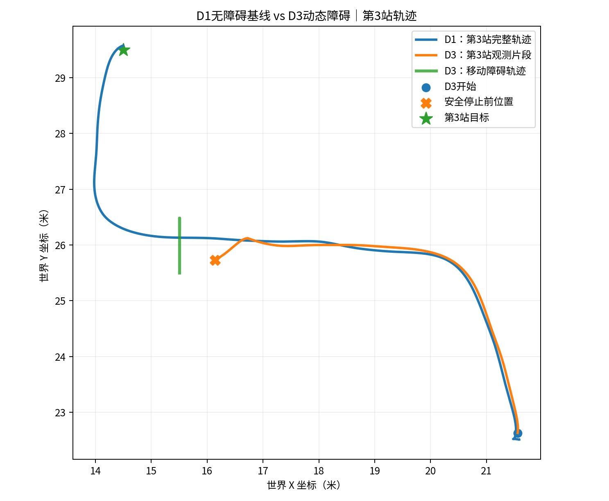
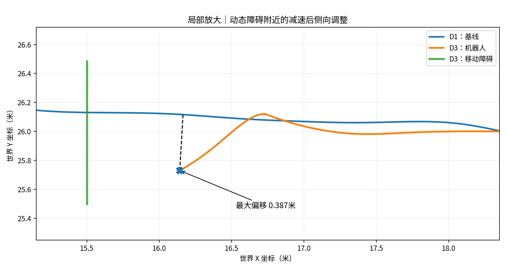
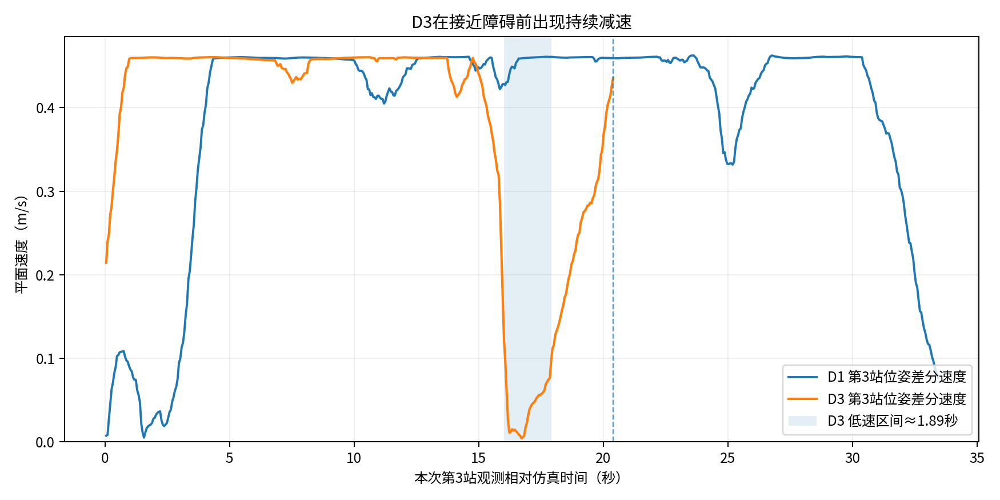
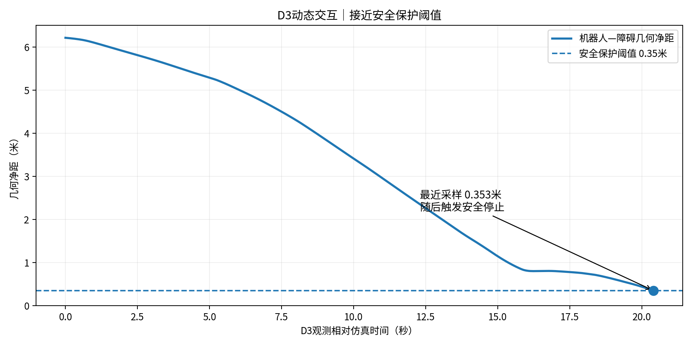

# Embodied-Agent｜D1与D3轨迹对比分析

## 原始数据
- `D1_retry_20261109_122902_735173165.json`：无障碍基线。
- `D3_heartbeat_20261109_170747_737199338_metrics_final.json`：动态障碍。
- 两次均为 `inspection_world`，相同计划，但并非随机化、严格配对的因果实验。

## 定量发现
- D1第3站完整轨迹约13.124米；D3第3站仅覆盖前20.394仿真秒、7.807米，不能直接比较完整任务路线长度。
- D3位姿到D1第3站实测轨迹折线的最大空间偏离约0.387米，发生在D3安全停止前。
- 同一X区间（16.5—17.0米）中，D1机器人平均平面速度约0.460m/s，D3约0.143m/s，降低约69%；D3另有约1.89秒连续低于0.1m/s。
- D3机器人与障碍最小观测几何净距0.35295米，之后原生插件安全停机，报告`ROBOT_CLEARANCE_GUARD`；零速度命令锁存确认，最终清理`CLEAN`。
- D3动态障碍运动至少发生3次观测到的方向反转。
- 两次任务3均SUCCEEDED：D1用时33.51秒，D3用时37.76秒，差4.25秒（12.7%），但不应将全部用时差严格归因为障碍。
- D3本轮只完成20.394秒观测，未完成25秒配置时长，因安全保护提前结束；质量标记`INCOMPLETE`，接触传感器`NOT_MEASURED`。
- `path_publications=22`和`observed_same_task_path_changes=21`是路径发布与变化代理指标，不等价于21次Nav2规划。

## 判断
D3轨迹显示先减速、随后明显偏离D1基线。结合用户Gazebo现场观察，支持混合避障行为（减速与绕行并存）。但不能从两次不同运行绝对证明所有偏离均由动态障碍引起，也不能声称零碰撞。

## 图表

